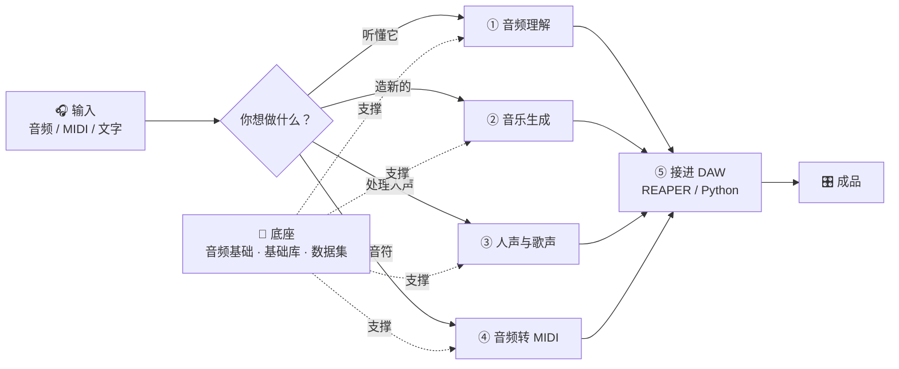

# 音乐 AI 技术栈

> 一个音乐人整理的音乐 AI 地图 —— 从**听懂声音**，到**生成音乐**，到**接进 DAW**。

[](LICENSE)


---

## 这是什么

**不是**教程搬运站，**不是**工具收藏夹。

是一张**地图**：告诉你这个领域有哪些路、每条路通向哪、以及**我现在走到哪了**。

开源 AI 项目死得很快。这个仓库里每个工具都标了维护状态，避免你照着两年前的教程踩空。

---

## 全景图



---

## 五个方向

| # | 方向 | 一句话 | 典型任务 | 文档 |
|---|---|---|---|---|
| ① | **音频理解** | 让机器听懂 | 转写歌词、分离人声伴奏、测节拍调性 | [02](docs/02-音频理解.md) |
| ② | **音乐生成** | 从文字或音频造音乐 | 文字生音乐、续写、风格迁移 | [03](docs/03-音乐生成.md) |
| ③ | **人声与歌声** | 处理人的声音 | 歌声合成、音色转换、克隆 | [04](docs/04-人声与歌声.md) |
| ④ | **音频转 MIDI** | 声音变成音符 | 旋律转 MIDI、鼓点转 MIDI | [05](docs/05-音频转MIDI.md) |
| ⑤ | **DAW 集成** | 把 AI 接进工作流 | REAPER 脚本、批量处理 | [06](docs/06-DAW集成与自动化.md) |

**底座**：[音频基础](docs/01-音频基础.md) · [数据集](docs/07-数据集.md) · [学习路径](docs/08-学习路径.md)

---

## 我该从哪开始

**别从工具表开始，会淹死。** 按这个顺序：

```
1. 读 docs/01-音频基础.md
   → 搞清楚波形、频谱、采样率在 AI 里长什么样（30 分钟）

2. 读 docs/08-学习路径.md
   → 看你现在的水平适合从哪个方向切入

3. 挑一个方向，只挑一个
   → 做音乐的，建议从 ⑤ DAW 集成 或 ④ 转 MIDI 开始
     因为这两个能立刻用在你现有的工作流里

4. 跑通一个最小例子，写进 notes/
   → 别贪多
```

---

## 每个工具都有状态标记

| 标记 | 意思 | 怎么办 |
|---|---|---|
| 🟢 **活跃** | 近期有提交，社区在动 | 放心用 |
| 🟡 **放缓** | 能用，但更新变慢 | 可以用，别指望新功能 |
| 🔴 **停更** | 长期没动或已归档 | 能用就用，新项目别选它 |
| ⚪ **被取代** | 有更好的替代品 | 文档里会写替代品是哪个 |

> **看一个 AI 项目值不值得投入，先看它 GitHub 最后一次 commit 是什么时候。**
> 这比 star 数有用得多。

---

## 我的进度

> 这张表是这个仓库存在的主要理由。定期更新。

| 方向 | 状态 | 说明 |
|---|---|---|
| 音频基础 | 🟡 学习中 | 采样率、STFT、Mel 的概念清楚，实际调参还在踩坑 |
| 音频理解 | 🟡 用过 | 跑过语音转写；声源分离待试 |
| 音乐生成 | ⚪ 未开始 | |
| 人声与歌声 | ⚪ 未开始 | |
| 音频转 MIDI | 🟡 用过 | 做过 MIDI 读写，模型还没接 |
| DAW 集成 | 🟢 在用 | REAPER + Python 脚本，日常在用 |

**图例**：⚪ 未开始 · 🟡 学习中/用过 · 🟢 日常在用 · 🔵 能教别人

---

## 目录结构

```
.
├── README.md
├── docs/                      按方向拆开的说明
│   ├── 00-怎么用这个仓库.md
│   ├── 01-音频基础.md
│   ├── 02-音频理解.md
│   ├── 03-音乐生成.md
│   ├── 04-人声与歌声.md
│   ├── 05-音频转MIDI.md
│   ├── 06-DAW集成与自动化.md
│   ├── 07-数据集.md
│   └── 08-学习路径.md
├── stack/
│   └── 工具总表.md            所有工具汇总成一张大表
└── notes/                     我自己的实践笔记
    ├── README.md
    └── _模板.md
```

---

## 关于准确性

- 工具的**链接和维护状态**：写的时候核实过，但会过期。发现不对请提 Issue
- 我的**个人笔记**：主观经验，可能有错，以官方文档为准
- **学习路径**：主观建议，不是唯一答案

**重要**：AI 音频领域变化很快。任何超过半年的工具推荐，都请自己去 GitHub 确认现状。

---

## 许可

[MIT](LICENSE) —— 文档和代码随便用。
